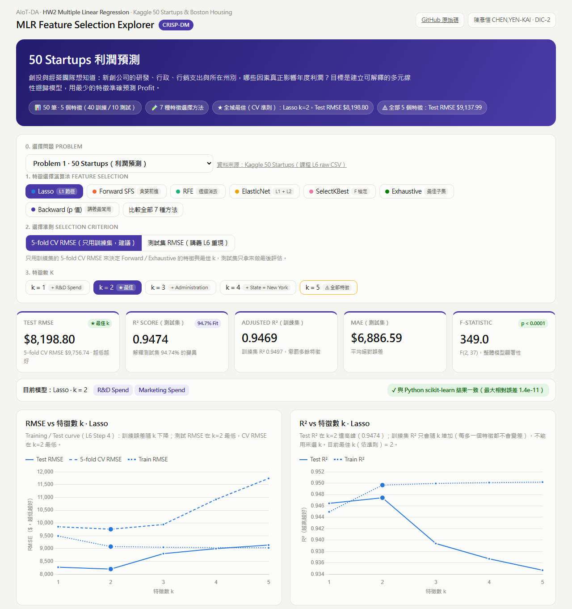

# 陳彥愷 CHEN,YEN-KAI_DIC-2 kaggle 50 startup and boston housing

**MLR Feature Selection Explorer**：用 CRISP-DM 解兩個多元線性迴歸問題，做成可互動的 GitHub Pages 網站。

[](https://a0966411725-png.github.io/kaggle-50-startup-and-boston-housing/)

完整頁面截圖：[Problem 1 · 50 Startups](docs/screenshot-startups-full.png) · [Problem 2 · Boston Housing](docs/screenshot-boston-full.png)

🌐 **網站**：https://a0966411725-png.github.io/kaggle-50-startup-and-boston-housing/

📦 **原始碼**：https://github.com/A0966411725-png/kaggle-50-startup-and-boston-housing

| | Problem 1 | Problem 2 |
|---|---|---|
| 資料集 | Kaggle 50 Startups（50 筆，4 個原始特徵 → 5 個編碼後特徵） | Kaggle Boston Housing（506 筆，13 個特徵） |
| 目標 | `Profit` 利潤 | `medv` 房價中位數（千美元） |
| 做法 | 手動用 scikit-learn 依 CRISP-DM 完成（課程 L6） | **直接套用 Claude Skill `mlr-crisp-dm`**（課程 L7 資料） |
| 切分 | `train_test_split(test_size=0.2, random_state=0)` | `train_test_split(test_size=0.2, random_state=42)` |

## 網站功能

- **下拉選單切換兩種 problem**（加分 1），另有第三個選項「Custom 自訂資料集」。
- **可輸入任意 Dataset**（加分 2）：貼上任何 CSV 的 raw 網址（例如 `https://raw.githubusercontent.com/Avik-Jain/100-Days-Of-ML-Code/master/datasets/50_Startups.csv`）或上傳檔案，選目標欄位後，整套分析都在瀏覽器裡跑。
  - 數值欄位直接使用，類別欄位自動 one-hot，文字/ID 欄位自動排除，缺失值、常數和完全共線的欄位會自動處理；只出現一兩次的稀有類別也能正常分析。
  - 如果輸入的資料和內建 problem 相同（例如上面的網址），會自動套用相同的 random_state 和 test_size，結果和內建頁面完全一致。
  - 網址也可以直接帶參數：`?problem=custom&csv=<raw 網址>&target=<欄位>`。
- **七種特徵選擇方法**：Lasso、Forward SFS、RFE、ElasticNet、SelectKBest（F 檢定）、Exhaustive 暴力搜尋、Backward Elimination（p 值，講義 L6 Part 5「最常用」的方法），以及「比較全部」模式，k = 1…p。
- **兩種選擇準則**：
  - *5-fold CV RMSE*：只用訓練集，是正確的做法（預設）。
  - *測試集 RMSE*：課程 L6 的做法，可以完全重現講義的 Results Table。
- 指標卡（Test RMSE、R²、Adjusted R²、MAE、F 統計量）、RMSE / R² 對 k 的 training-test 曲線、OLS 迴歸方程式、係數表（標準誤、t、p 值、95% CI、VIF）、實際值與預測值散布圖、測試集殘差與離群值表。
- **多元迴歸五大假設檢驗**：線性（Ramsey RESET）、殘差常態（Jarque–Bera）、同質變異（Breusch–Pagan）、誤差獨立（Durbin–Watson，依資料原本的列順序計算）、無共線性（VIF）。
- **即時預測**：可用滑桿輸入，輸出預測值和 95% 預測區間，也能下載模型 JSON。
- **CRISP-DM 六步驟分頁**：內容依目前的問題與資料自動產生，包含相關係數長條圖、最相關特徵的散布圖，以及商業成功標準的逐項檢核。
- **可驗證**：瀏覽器端的 JavaScript 引擎（`js/engine.js`）會重算所有數字，並和 Python（scikit-learn / statsmodels）的結果比對。兩個內建問題的全部方法、全部 k、所有假設檢定都吻合，相對誤差 ≤ 2e-11；網頁上會顯示綠色的「✓ 與 Python scikit-learn 結果一致」。瀏覽器也用 MT19937 重現了 numpy 的亂數，所以自訂資料的切分和 sklearn `train_test_split(random_state=…)` 完全相同。

## Problem 1 — 50 Startups（手動 CRISP-DM）

1. **Business Understanding**：哪些支出與州別影響新創公司的利潤？目標是用最少的特徵準確預測 Profit。成功標準：測試集 R² ≥ 0.90、最多 3 個特徵、所有係數顯著（p < 0.05）、最大 VIF < 5。
2. **Data Understanding**：50 筆，沒有缺失值；R&D Spend 和 Profit 的相關係數 r = 0.97。
3. **Data Preparation**：`State` 做 one-hot（`drop_first=True`，避免 dummy variable trap），切成 40 筆訓練、10 筆測試。
4. **Modeling**：用 `LinearRegression` 搭配七種特徵選擇方法（k = 1…5），另外用 Optuna 調 Lasso 的 α。
5. **Evaluation**：Forward Selection（以測試集 RMSE 挑選，講義做法）的結果和講義完全相同。

   | k | Selected Features | RMSE | R² |
   |---|---|---|---|
   | 1 | R&D Spend | 8,274.87 | 0.946459 |
   | 2 | R&D Spend, Marketing Spend | **8,198.80** | **0.947439** |
   | 3 | + State_New York | 8,309.06 | 0.946015 |
   | 4 | + State_Florida | 8,409.92 | 0.944697 |
   | 5 | + Administration | 9,137.99 | 0.934707 |

   改用只看訓練集的 5-fold CV 挑選時，推薦模型一樣是 **k = 2（R&D Spend + Marketing Spend）**，測試集 RMSE 為 $8,198.80、R² 為 0.9474：
   `Profit = 46,346.34 + 0.7886 × R&D Spend + 0.0326 × Marketing Spend`

   **成功標準檢核**：R² 0.9474 ✓、2 個特徵 ✓、最大 VIF 2.10 ✓；「所有係數顯著」✗，因為 Marketing Spend 的 p = 0.071。若要求所有係數都顯著，Backward（p 值）會停在只用 R&D Spend（測試集 RMSE $8,274.87，只差 0.9%），也就是講義說的「只有 R&D 那項最有效」。這是「精簡、可解釋」和「預測誤差」之間的取捨。

   **假設檢驗**：RESET p = 0.056（線性可接受）、Breusch–Pagan p = 0.22（同質變異）、VIF 2.10；Jarque–Bera p < 0.0001（殘差有離群值，不是常態）；Durbin–Watson 1.41（資料是依 R&D 由大到小排列，殘差沿著這個順序有相關，暗示還有一點模型沒抓到的結構）。

   另外，用測試集做 Exhaustive 搜尋時，會找到 k = 3（R&D + Administration + Florida），RMSE 為 $8,171.65，比講義的「最佳」還低。這正好說明拿測試集來挑特徵，等於在對測試集過擬合；網站的「講義重現」模式會標出這個警告。
6. **Deployment**：`models/startups_ols.pkl.gz`（pickle + gzip），網站上的即時預測器和模型 JSON 下載。

程式：`analysis/startups_lecture_l6.py`（講義風格的手寫版本）；完整報告：[reports/startups_crisp_dm.md](reports/startups_crisp_dm.md)。

## Problem 2 — Boston Housing（套用 Skill）

Problem 2 沒有另外手寫程式，而是直接執行 Claude Skill [`mlr-crisp-dm`](.claude/skills/mlr-crisp-dm/SKILL.md)。這個 Skill 把 Problem 1 的流程包成可重複使用的 workflow。

**Skill 套用紀錄**
1. 抓取並檢查資料（Skill 步驟 1）：506 × 14，沒有缺失值；`chas` 是 0/1 的虛擬變數；`medv` 在 50.0 有上限截斷；`lstat`（r = −0.74）和 `rm`（r = +0.70）和房價最相關。
2. 撰寫設定檔 [`problems/config/boston.config.json`](problems/config/boston.config.json)（Skill 步驟 2）：目標欄位、單位、欄位中文名稱、商業目標，以及在看結果之前就訂好的成功標準。
3. 執行 `python analysis/mlr_workflow.py problems/config/boston.config.json`（Skill 步驟 3），產生 `problems/boston.json`、`reports/boston_crisp_dm.md`、`models/boston_ols.pkl.gz`，並自動加進下拉選單。
4. 檢查結果並在瀏覽器驗證（Skill 步驟 4–5）：七種方法的所有 k 和所有假設檢定都和 sklearn / statsmodels 一致。

**結果**（測試集 102 筆）
- 全部 13 個特徵：RMSE 4.93（千美元），R² 0.669。
- 用 5-fold CV 挑選的推薦模型：**k = 10**（刪掉 `zn`、`indus`、`age`），CV RMSE 4.81，測試集 RMSE 5.05，R² 0.652。Backward（p 值）也正好停在這 10 個特徵，所有係數 p < 0.05，最大 VIF 7.09。
- **成功標準檢核**：R² ≥ 0.65 ✓（0.652）、所有係數顯著 ✓、VIF < 10 ✓；「RMSE < 5」✗（5.05）。
- **假設檢驗**：線性明顯不成立（RESET p = 4.7e-28），從資料理解頁的散布圖也看得出 `lstat` 和房價是彎曲的關係；殘差不是常態、有異質變異（JB、BP 的 p 值都 < 0.05）；Durbin–Watson 1.09（資料依地區排列，相鄰地區的殘差相關）。所以 RMSE 沒有達標的主因是線性模型本身的限制，下一步可以加入 log(`lstat`)、`rm`² 這類非線性項。
- 用測試集挑選（講義做法）會選到 k = 8，RMSE 4.54，但這個數字偏樂觀。另一個例子：Forward 以測試集 RMSE 為準則時，最重要的 `rm` 到第 13 步才被選進來，可見用測試集選特徵很不可靠。
- 資料倫理：`b` 欄位是用族群比例建構的，scikit-learn 已經移除這個資料集；這裡保留它，只是為了和課程 L7 比較。

完整報告：[reports/boston_crisp_dm.md](reports/boston_crisp_dm.md)。

## 執行方式

```bash
pip install -r requirements.txt
python analysis/startups_lecture_l6.py                              # Problem 1 講義版
python analysis/mlr_workflow.py problems/config/startups.config.json # 產生網站用的資料
python analysis/mlr_workflow.py problems/config/boston.config.json
python -m http.server 8000                                          # 開啟 http://localhost:8000
```

`requirements.txt` 固定了產生結果時用的套件版本；`models/*.pkl.gz` 需要相同版本的 scikit-learn 才能載入。

GitHub Pages 由 `.github/workflows/pages.yml` 在 push 到 `main` 後自動部署（Settings → Pages → Source 選 **GitHub Actions**）。

## 檔案結構

```
index.html, css/, js/engine.js (計算引擎), js/app.js (介面)
data/                    50_Startups.csv, BostonHousing.csv
problems/config/         每個 problem 的設定檔（Skill 的輸入）
problems/*.json          workflow 的輸出（網站讀取，含 sklearn 對照數字）
analysis/mlr_workflow.py 通用 CRISP-DM workflow（Skill 呼叫）
analysis/startups_lecture_l6.py  Problem 1 講義風格版本
reports/                 各 problem 的 CRISP-DM 報告
models/                  pickle + gzip 模型
.claude/skills/mlr-crisp-dm/SKILL.md  Claude Skill
```

## References

- 50 Startups：https://www.kaggle.com/code/akash17/50-startups-linearregression
- Boston Housing：https://github.com/selva86/datasets
- 版面參考：https://huanchen1107.github.io/AIoT-DIC2-MultipleLR/
- 方法：CRISP-DM、scikit-learn、statsmodels、Optuna、Chart.js
